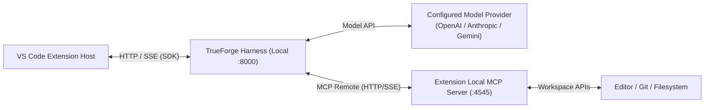

# TrueForge AI Coding Agent for VS Code

[](https://github.com/truefoundry/trueforge)
[](https://opensource.org/licenses/MIT)
[](https://www.typescriptlang.org/)

An intelligent, repository-aware coding agent built as a Visual Studio Code extension for the **TrueFoundry Forge-a-thon at Techfest, IIT Bombay 2026–27**.

Powered by **TrueForge**, TrueFoundry's open-source agent harness, with custom editor capabilities exposed via the **Model Context Protocol (MCP)**.

---

## 🎯 Core Capabilities

1. **Inline Editing (`Ctrl+K` / `Cmd+K`)**: Select any code snippet, invoke natural-language instructions, preview diffs in-editor, and accept or reject per hunk.
2. **Autonomous Agent Mode**: High-level repository exploration where the agent independently navigates files, searches code with ripgrep, plans edits across multiple files, and runs verification commands.
3. **Explainable Context Assembly**: Explicit `@file` and `@symbol` mentions, automatic relevance retrieval, token budgeting, and full visibility into *why* context was selected.
4. **Hunk-by-Hunk Diff Safety**: Zero silent writes to disk. In-memory staging buffer with granular hunk acceptance/rejection and full undo history via VS Code `WorkspaceEdit`.
5. **Real-time SSE Streaming & Resilient Cancellation**: Token-by-token streaming, live activity timeline driven by TrueForge events, non-destructive cancellation, and automatic fallback across configured models.

---

## 🏛 Architecture



- **Harness Client**: Uses `@truefoundry/trueforge-sdk` to manage sessions, turns, and event streaming.
- **Editor MCP Server**: Exposes `read_file`, `search_workspace`, `list_files`, `find_symbol`, `propose_edit`, and `run_terminal` to TrueForge over standard remote MCP.
- **Diff Review Engine**: Buffers proposed changes, calculates unified diff hunks, and safely applies accepted changes with transaction rollback.

---

## 🚀 Getting Started

### Prerequisites
- Node.js >= 20
- npm >= 10
- Git

### Installation & Build

```bash
# Clone the repository
git clone https://github.com/madhavgairola/iitb-hackathon.git
cd iitb-hackathon

# Install dependencies
npm install

# Compile & bundle extension
npm run build

# Run unit test suite
npm test
```

### Running in VS Code
1. Open this repository in Visual Studio Code.
2. Press `F5` to launch the **Extension Development Host**.
3. Use `Ctrl+K` (or `Cmd+K`) to invoke inline editing, or open the **TrueForge Agent Workspace** sidebar.

---

## 🧪 Competition Evaluation Fixtures

Prepared for the official Flask 3.1.3 evaluation benchmark (`commit: 22d92470`):
- **Task A (Inline Edit)**: `src/flask/helpers.py` (`get_debug_flag`)
- **Task B (Autonomous Multi-File)**: Built-in CLI command `flask config` with secret masking, tests, and documentation.
- **Task C (Resilience)**: Network/credential fault tolerance with automatic secondary model failover.

---

## 📄 License
MIT
